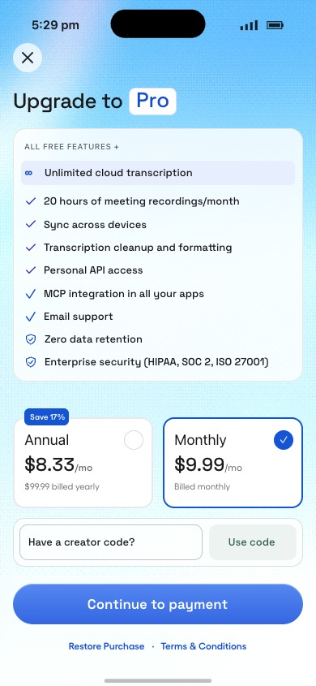

# Pro paywall facelift — blue draft, 14 October 2026

Status: **reviewable, unpublished Superwall draft; approved CTA simplification implemented**. Josh confirmed target 271365 and then explicitly selected the blue design. No Publish, campaign change, mobile release, financial transaction, real redemption, or live creator validation request was executed. Purchase, restore, and callback actions were exercised through the editor’s explicit simulation UI during the parity follow-up.

## Provider identity and persistence

- Application 38286; existing paywall **271365**, `Creator Code TEST DRAFT 2026-09-25`.
- Last saved provider baseline: revision **12** (Sep 26, 2026, 2:59 AM as displayed). The facelift is in the editor's local **Unsaved Changes** draft, above that baseline. It survives reload. It has **not** created a newly published revision or a server-side saved-release claim.
- Campaign 109201 remains restricted to bundle `com.openwhispr.creatorcode.probe20260925`, placement `creator_code_probe_20260925`, with no catch-all. Live onboarding campaign 110528 still uses paywall 239043. No routing was edited.
- The complete exported draft in `after-tree.json` is the durable review/rollback record alongside the existing editor draft. The official editor documentation says unpublished changes persist locally until sign-out: https://superwall.com/docs/dashboard/dashboard-creating-paywalls/paywall-editor-publishing . Keep the editor session available; do not sign out and assume a remote revision exists.

## Design applied

The source is greatcoat/titan commit `f474ca1075f4a50b033fcbc82f4d39397d7c5480`, `artefacts/reports/2026-10-13-pro-paywall-prototypes.html`. The exact embedded blue artwork was extracted and uploaded to Superwall, without generating replacement artwork. Provider asset: `https://user-content.superwalleditor.com/user-content/Qk5W_puKFGoJ0Ezp1vSpv.png` (786×1704; 1,775,075 bytes). It renders at 81% opacity with translucent benefit/form panels and footer.

The draft includes the flat Pro keycap, all nine benefits, annual/monthly cards and selection indicators, catalog-bound prices, computed annual savings, 50px glossy CTA, directly visible monthly creator form, 108px action width at normal text size (8em, scaling with larger text), loading spinner, verified Applied check, read-only accepted code, concise error copy, and preserved close/restore/terms routes. The spinner SVG respects reduced motion. Annual hides the creator area and shows ordinary monthly catalog pricing on the unselected Monthly card. Returning to Monthly restores the verified offer presentation.

No app-source presentation change was needed: Superwall owns these visuals. This PR contains the exported configuration, evidence, and an executable contract verifier rather than unrelated app changes.

## Functional comparison

`verify-facelift-contract.mjs` compares saved revision 12 to the final exported draft. **Every original node remains, and every original click-action property is byte-identical except the explicit recovery control.** The blocking apply callback, its payload and callback leaf resets, redemption callback, CTA guard ordering, products, default plan, restore, terms, and dismissal actions remain intact. The verified monthly price binding is identical; the verified renewal branches are identical, with only the ordinary fallback shortened to “Billed monthly.”

Josh approved removing the secondary Continue without code CTA on 14 October 2026. The old explicit-recovery requirement is superseded by this decision:

- Empty input uses ordinary selected-product payment. Failed or unavailable codes also allow ordinary payment, whether text remains or is cleared, with catalog pricing displayed.
- Checking remains blocked. Unchecked nonempty input and incomplete offer responses retain their existing guards. Complete verified offers retain the existing redemption callback.
- The retired secondary CTA is hidden unconditionally. A mutually exclusive visual variant of the main CTA handles Monthly error/unavailable with the same by-selected purchase action as the original ordinary fallback. The original complex callback guards are unchanged. Both variants share the same label and 50px geometry; exactly one is visible.
- `state.creatorOpen` remains true for the directly visible form. Error copy is “Code wasn’t applied.” Feedback now uses the full row width.

The accepted-code display duplicates the original success visibility condition. It cannot show Applied merely because a callback resolved; all original required price/renewal/token checks must pass. The original input and apply control remain hidden under the original ready condition, so the accepted display is read-only.

## Validation and limits

- **26 exported-configuration checks pass**: `contract-results.txt`. Run from repository root with Node 24: `node openwhispr-mobile/scripts/creator-paywall-probe/verify-facelift-contract.mjs`.
- **125 existing tests / 9 suites passed** against the unchanged affiliate source at the baseline: `baseline-tests.txt`. No native affiliate, attribution, validation, backend, or purchase source was edited afterward. Josh confirmed that the Apple purchase flow had already been tested. This follow-up preserves that implementation and tests the changed UI conditions; repeating Apple transactions is not a prerequisite for this UI update.
- Interactive editor checks include actual Use code → Checking → simulated Failure → Try again; retry re-enters Checking; simulated Success without offer fields stays blocked. Complete seeded offer shows Applied and a read-only entered code; Annual hides creator controls and restores ordinary pricing; Monthly restores the accepted presentation; failed and unavailable states retain the regular catalog price and active main CTA; cleared failed input also permits payment. Checking and fieldless Success stay blocked. These latest checks use the editor callback simulator; unavailable and complete offer states use temporary preview overrides. Editor purchase simulation selects secondary for Monthly and primary for Annual; a complete seeded offer triggers the redemption callback; Restore triggers its existing action. No native transaction or live validation occurred.
- The success/loading screenshots use explicitly temporary **preview fixtures**, including `PREVIEW20` and `$7.99`. They are not a validated creator, live discount, or assigned offer. All fixture overrides and input text were removed before the final readback. `after-variables.json` records empty/false offer defaults and null overrides.
- Final compact 375×667 with temporarily enlarged 125% font sizes: 375px scroll/client width, 60px entry/checking form, 44px controls, 135px action. After scrolling, form bottom is approximately 520px and CTA top is 541px: the expected 21px separation. Error/recovery also remains reachable with the same clearance. A fixed 108px grid column was caught and replaced with an automatic column during this check. All temporary font sizes were restored; native Dynamic Type is still unverified.
- Screenshot names beginning `preview-` record the earlier handoff’s intermediate state/size checks and are superseded for layout by this follow-up. `after-blue.jpg` is the final default blue preview. These are editor renderings, not native app screenshots.
- Final readback was rechecked after reload. `after-reload-tree.json` records the final persisted local draft; it is not proof of a publish.

## Parity correction after review

Josh correctly identified that the first draft placed the plan cards and code form under the benefits instead of against the payment footer. This follow-up replaces the arbitrary bottom padding with a viewport-height scroll area and flexible space above the cards. The 135px fixed footer now reserves a non-shrinking 50px CTA and 44px legal row. The earlier parity correction placed error text and recovery in a wrapping feedback row; the later approved CTA simplification removes recovery from that row and gives feedback full width. Existing node identities/actions remain unchanged. Benefit and heading fonts now consistently use Space Grotesk.

Matched-size comparison used the approved HTML with only its preview dimensions changed from 393×852 to the provider’s 390×845. Coordinates are CSS pixels from the phone’s top edge:

| Element | Prototype y / height | Final editor y / height |
| --- | --- | --- |
| Plan cards | 514.11 / 111.89 | 514 / 112 |
| Creator form | 638 / 60 | 638 / 60 |
| Continue to payment | 719 / 50 | 719 / 50 |
| Footer | 710 / 135 | 710 / 135 |

Entry, checking, and Applied retain the same form/field/action footprint. The input and action are 226×44 and 108×44 at standard size. Applied was exercised with clearly labeled preview offer parameters; callback Failure and fieldless Success were exercised with the editor’s actual callback simulator. These checks prove editor presentation and wiring, not backend validation or native acceptance.

The final font and layout changes were followed by a fresh reload and clean-default export. At that layout-only checkpoint, 19 contract checks passed and no click-action property changed. The subsequent approved CTA simplification now has 26 checks, including retained/cleared failures, stale-offer pricing, mutually exclusive CTA visibility, and unchanged verified redemption. The earlier layout and its evidence remain recoverable at commit `d5408795d97e9cd60f910a6dfea555fd338f6399`.

## Remaining visual review scope

The previously documented empty-failed-input behavior is now explicitly approved, not an open payment defect. Josh confirmed prior Apple flow testing; the native purchase and offer-redemption implementation remains unchanged.

The separate visual review notes remain: native rendering/accessibility/reduced-motion appearance has not been rechecked for this draft, and a true 160ms checking-to-Applied crossfade has not been demonstrated. Neither note reopens the established Apple transaction baseline. No publish or routing change is included in this update.

## CTA simplification validation

- Editor Use code → Checking → Failure retains EXAMPLE, shows the $9.99 catalog price and one Continue to payment button, and simulates purchase of secondary.
- Retry re-enters blocked Checking. Success without required offer data stays blocked.
- Complete preview offer shows $7.99 / First 3 payments / Applied and routes through the existing redemption callback.
- Unavailable preview state, even with stale seed offer values, restores $9.99 / Billed monthly and simulates purchase of secondary.
- Clearing failed input retains enabled regular payment. Annual simulates purchase of primary.
- Compact 375px preview has equal client/scroll width; feedback is 323px wide without horizontal overflow and the main CTA retains its 50px authored height.
- Temporary overrides/input were cleared before export and reload. `regular-error-final.jpg` captures the changed failure presentation; `after-blue.jpg` is the clean default.

## Evidence and rollback

- `before-tree.json`: original inspected editor tree, 69 nodes.
- `saved-revision-12-tree.json`: exact saved revision loaded before edits. Differences from the first export were rendered catalog text; authored properties were unchanged.
- `before-products.json`, `after-products.json`: catalog identity/order/default comparison.
- `before-variables.json`, `after-variables.json`: authored/default state only, excluding user/device records.
- `after-tree.json`, `after-reload-tree.json`: complete draft configuration and persistence readback.
- `before.jpg`, `after-blue.jpg`, `preview-*.jpg`: provider preview evidence, labeled above.
- `sha256.json`: integrity hashes. No controller credentials, private offer URL, or preview token is stored in the published definition.

To roll back the provider draft, use revision history to restore revision 12 after preserving any later human edits. This document does not authorize publishing a rollback. The mobile PR has no runtime app code to roll back.

## Branch and handover

Repository `OpenWhispr/openwhispr`; stacked on affiliate PR #2334 head `3a434905b813eba100ac3320cb420d4171082d92`, branch `feat/mobile-affiliate-port-20260924`. Fresh main at baseline was `2516e6e000b866a06099f69fd851b914069653d4`.

Owned sparse checkout: `/Users/joshuadavidpadoa/dev/ow-pro-paywall-facelift-20261014`, branch `codex/pro-paywall-facelift-20261014`. **Kept** for the open draft PR and visual review follow-up; no copied dependencies, builds, or owned servers remain. Retire it when this draft handoff is accepted or superseded. Other sessions' worktrees and the primary Titan checkout were untouched.
